目录
（烘焙工具）
（烘焙工具Tips）
（世界分区的加载机制和切分）
（世界分区的代码梳理）
（世界分区下的HLOD层级关系）
（本次测试概述及问题）
（测试对比）
（经验总结和收集）
## 什么是HLOD ？
Hierarchical Level - of - Detail 系统的目的是提高远景的Actor 的 渲染Draw call,内存应用，模型面数和 材质复杂度。通过合并模型生成代理模型的方法实现优化效果。
这些生成的 HLOD模型将会 Switch in/out 基于加载距离/屏幕尺寸 去替换一个或者多个Source Actors 在特定的 Cluster/ Part of World。
基于不同的世界类型 World Composition 或者 World Partition 选择不同类型的HLOD 加载机制。

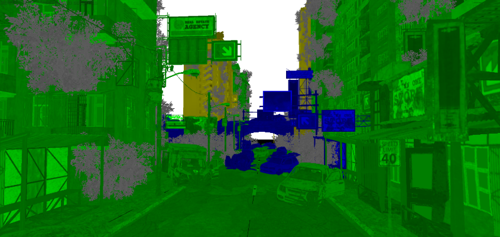

（接下来引用EPIC的官方文章）

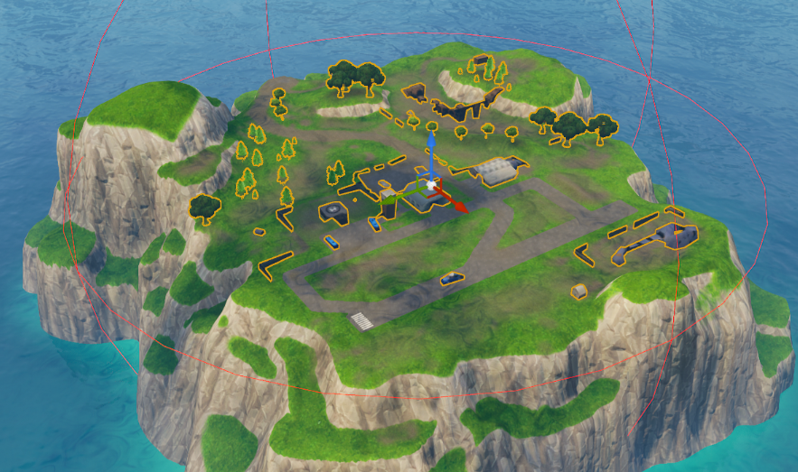

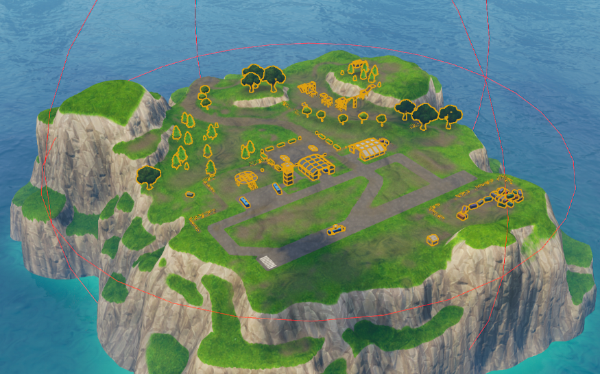

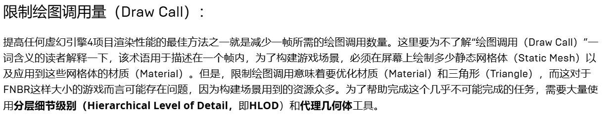

Source Actor                             HLOD Mesh

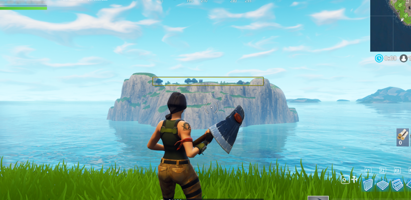

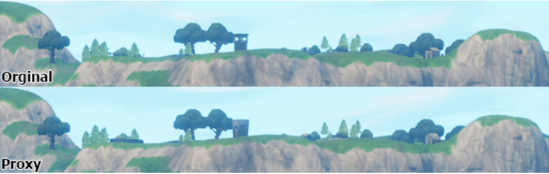

上图（标注为“Original”）显示了该区域没有使用HLOD和代理几何体的效果。这一小块（高亮）区域由424个静态网格体（Static Mesh）组成，需要渲染556,445个三角形。这就需要大量资源来创建一个面积小、距离远的资源。下图（标注为“Proxy”）显示了该区域使用HLOD和代理几何体工具之后的效果。现在，这一小块区域只需要一个静态网格体（Static Mesh），需要渲染1,215个三角形。当然，二者之间的视觉差异可能很小，但需要记住，玩家不会像我们这样放大这张图片。此外，考虑到这种做法对任何UE4项目带来的性能益处，即使远距离对象不会完美匹配原始对象，也是非常值得一试的做法。
在了解了用途和目的之后，接下来将从两个维度进行展开。
## HLOD 合并烘焙Mesh 管线
## UE 所提供的Mesh 烘焙工具以及算法梗概
针对不同烘焙的效果对比和实用范例
技巧和局限
HLOD的 Streaming 加载流程
UE提供的加载方式 WC/WP
WP空间切分法的底层逻辑和代码解析
加载方式代码解析
HLOD的加载配置方法
技巧和局限
## UE 所提供的Mesh 烘焙工具以及算法梗概（目录）

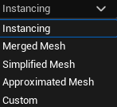

目前无论是WC 还是 WP 世界下 HLOD 的烘培提供了4种不同的计算方法。根据实际的情况酌情选择。
Instancing
这个类型下生成Instanced Static Mesh (ISM) 将会采用原始模型的最低一级LOD。这方面非常适合在最低级模型为 impost-er的类型。比如树木或植被等。

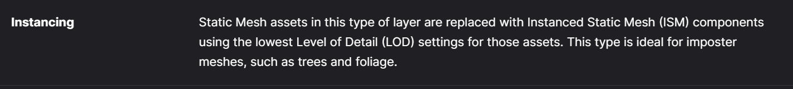

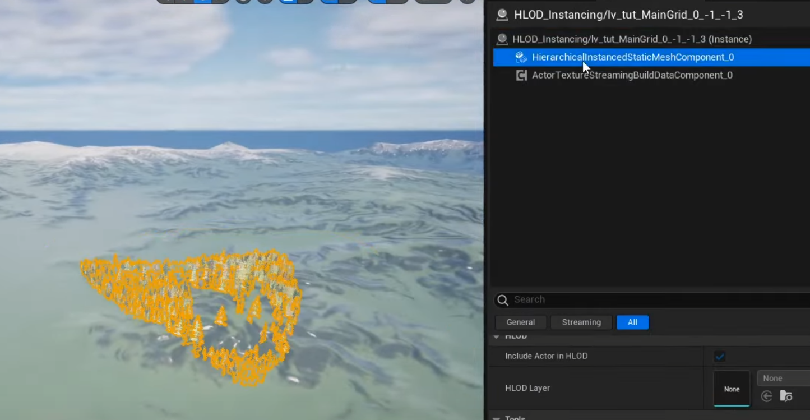

这里的实际上提升效率并不大，因为本身植被已经是HISM，是在impost-er层级下的渲染会在进行一次合批。

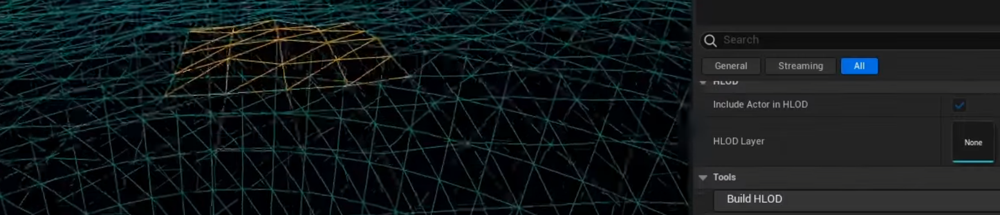

但是在Landscape 上的效果就非常显著。

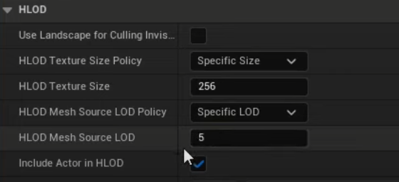

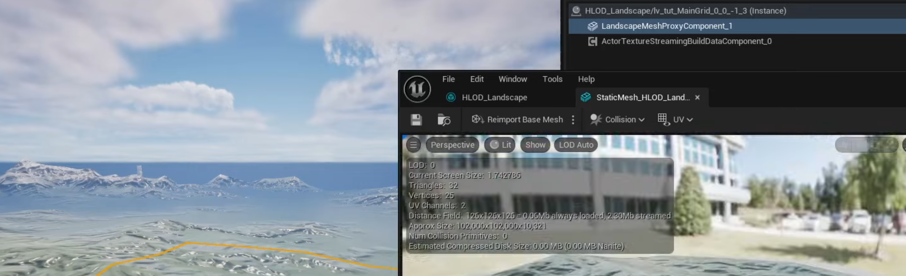

可以通过选择不同等级的LOD来决定模型的面数
Merged Mesh
这种类型是将所有的原始模型合并成为一个代理模型。

以下案例是由一些Box 拼搭起来的模型。

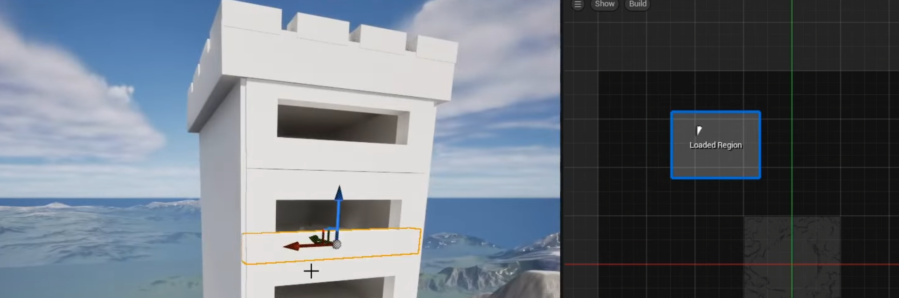

Merged 后会切分为2段模型文件，单纯只是将模型合并在一起。主要是可以将模型的材质进行合批。

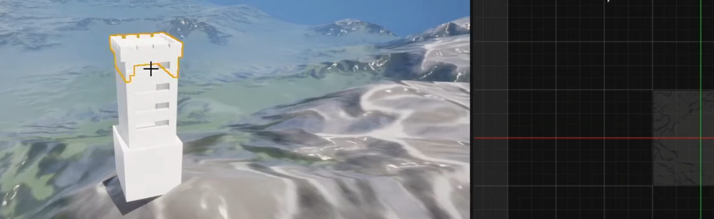

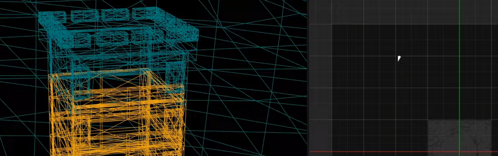

Simplified Mesh
是Merged Mesh 的进阶版本。经过合并之后，会焊接一些顶点以用于减少面数。(Merged by Distance) (take interior faces) (dissolve edges)

以下是生成Simplified 之后的效果

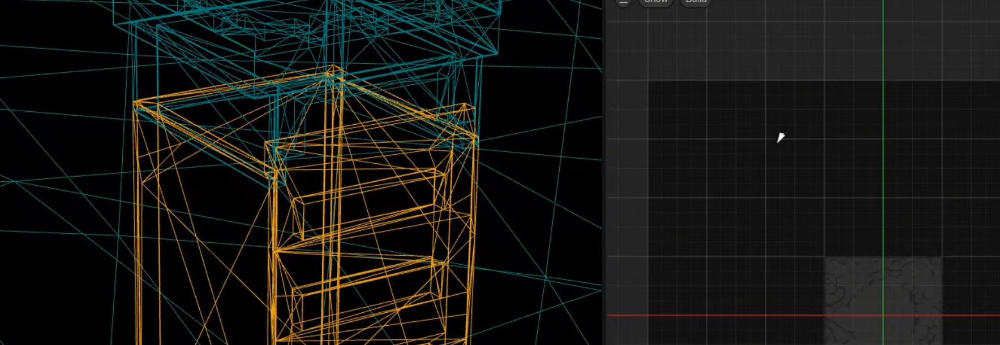

Approximated Mesh
是通过Voxel 进行Remesh 之后进行的简化版本。详情可以参考 Houdini 的 VDB from Polygons - Convert VDB 等Nodes

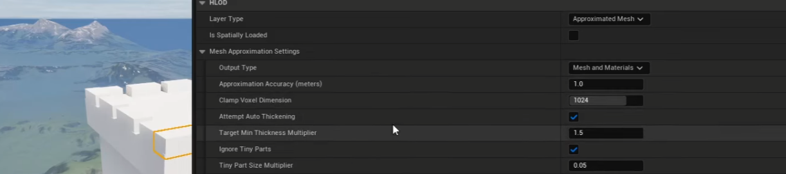

既然是VDB 转换就会带有标准的VDB 边缘效果。

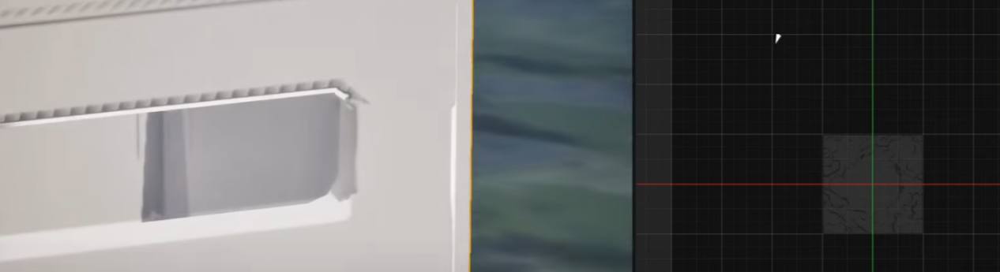

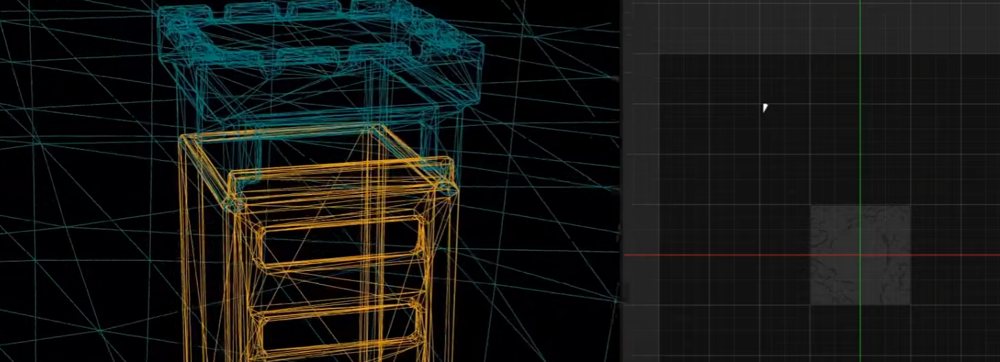

VDB 转化方面耗时最久，也是最容易崩掉内存的。
谁参与HLOD 并通过参数来设置对应的Actor。 尽量把很多小的道具或物件设置不要参与HLOD的烘培当中。

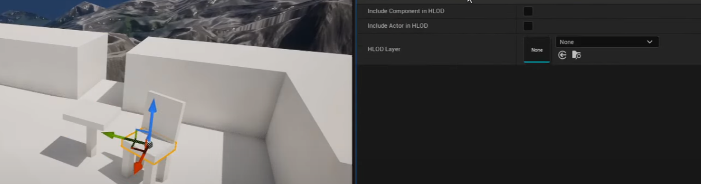

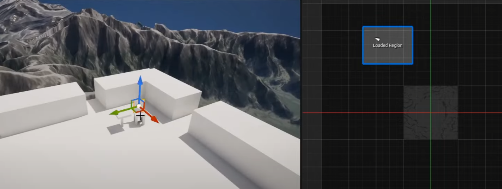

## 多种情况的多种选择   （目录）
在多种模型计算的方法下，针对不同的结果选择合适的配置项目才是最优的策略。
Instance 在很多方面可以进行 实力合并，并且采用最后一级别的LOD 模型进行合并。
Merged 只是材质上的合并，模型面数上没有做太多的修改，这样可以最大限度的保留原模型的轮廓。
Simplified 适用于绝大多数模型，只是在边缘和轮廓上很难有保证。具体要看模型本身的造型。
Approximated 则适用于更高的面数更复杂的造型，从时间成本上来计算，很高的模型使用Simplified 会慢于 Approximated.
HLOD 不是免费的
生成的新的模型，会匹配定的合并后的贴图。这里合并材质后基于勾选的通道会对应的生成对应的贴图。这样会消耗大量的内存资源。所以权衡不同平台的Run Time性能 和 内存，硬盘的最佳平衡点。

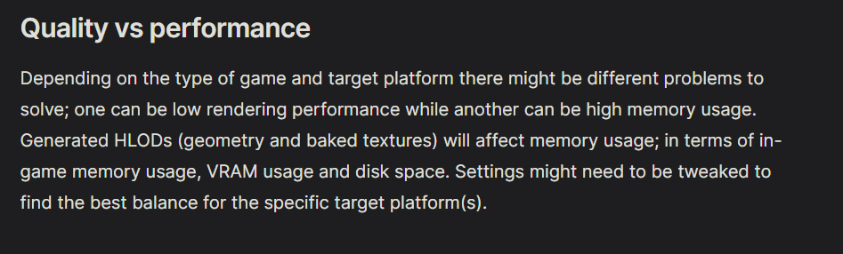

## UE 中的 HLOD 加载 （WP）  （目录）
基于UE5 推出了 World Partition。HLOD 的整体配置方法，加载机制也产生了第二套方法。我们着重讨论WP 下的HLOD。
## World Partition 解析
UE5在大世界解决方案上推出了全新的系统架构WP。和之前存在的World Composition 并行两套系统。其实本质上WC 和WP 之间在Streaming 底层逻辑一样。但是在前期的数据准备阶段有着天壤的区别。
在WP的世界中和WC 一样有个主World，World 承载了所有的External Actor。通过 Grid 来进行判断，判断Actor 相对于 Streaming Source 的加载卸载距离。

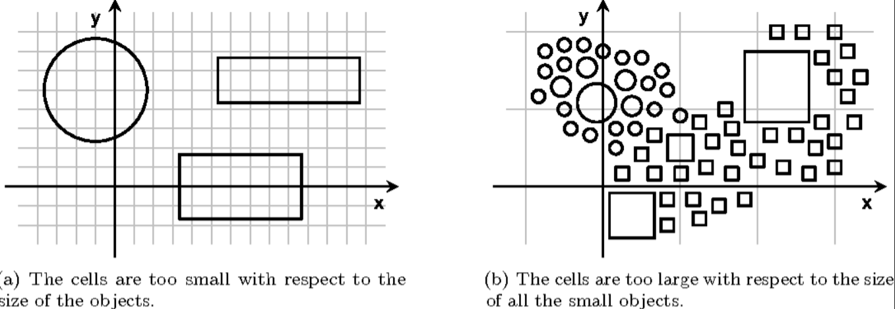

一个world 中可以有多个Grid, 他们的关系是1对N 的关系。完全可以按照不同类型设置不同的Grid。而每个Grid 中设置不同的Cell Size 和 Load Range 来合理的控制加载。
Grid/ Grid Level / Cell
每个Actor 的面板下可以选择这个Actor 所在的 Grid

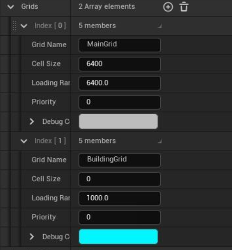

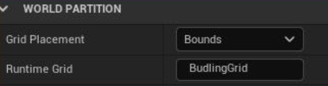

首先在run time的时候，UE会将所有的Grid的Actor
收集，然后根据Grid Size 去切分Grid Level[0]层，
看能切成多少个Cell,第0层的Cell 大小就是 Grid Size的大小。
之后继续往上扩展其他Grid Level 层。简单来说Grid Level[1] 的每个Cell 就是下层4个Cell 的合成。 数据结构就是四叉树。然后往上递归直到最上层有一个Cell, 就是world的大小Cell.

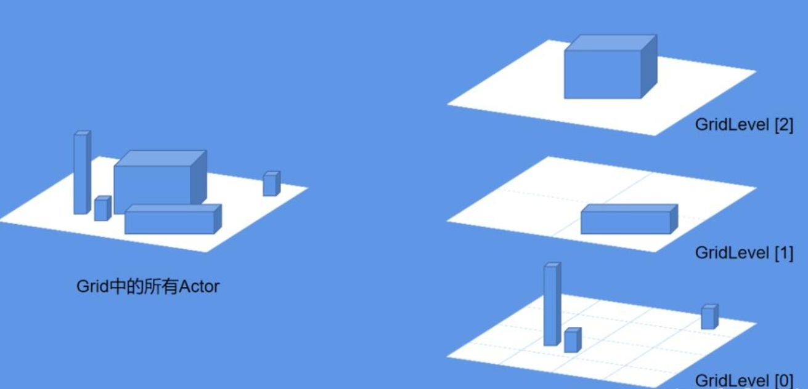

由于每个Grid中的Cell Size 是固定的，对于一些较大的Actor, 包围盒可能横跨多个Cell，这种情况下我们可以将原本的Cell Size 翻倍作为一级新的Grid Level, 重新判断。如果不能包含，依次类推，直到能找到包含Actor 的 Grid Level。
同时，当划分的时候有可能出现一部分格子空置的情况，这里的处理方式是只有至少包含一个Actor 的Cell 才会被创建，逻辑可以在Create Streaming Grid 的后面查看。 这里的Cell 命名也会加入对应的 Grid Level 和 Cell X - Y 信息，生成对应的Hash 值来生成实际的Cell Name.
WP的逻辑是先划分Cell，然后再看Cell内所有Actor属于哪个DataLayer，然后再决定这个Cluster属于哪个Cell。具体的划分结果，可以通过Saved/Log/WorldPartition/下找到详细的log。

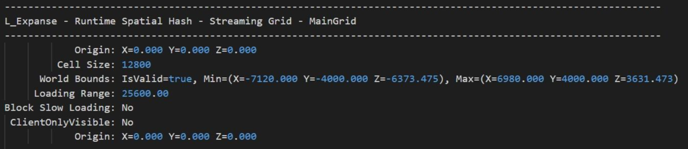

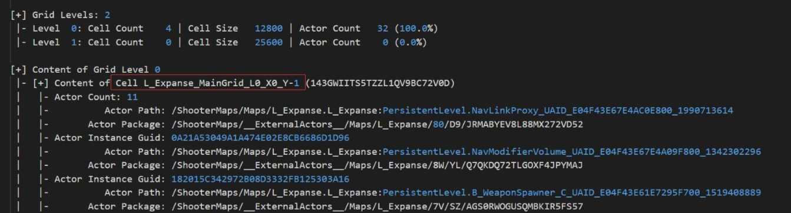

## 代码解析   （目录）
从UWorldPartition :: GenerateStreaming 开始，就进入了运行时划分Grid 的逻辑

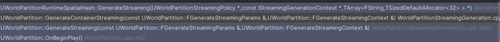

GenerateContainerStreaming中会先创建一个FHierarchicalLogArchive用于后续的Log记录，然后生成对应的StreamingGenerator来获取场景中所有的Actor信息，并构建一个FStreamingGenerationContext来存储后续需要用的Actor信息，包括ActorSet、ContainerID、bIsSpatiallyLoaded、RuntimeGrid、DataLayers等

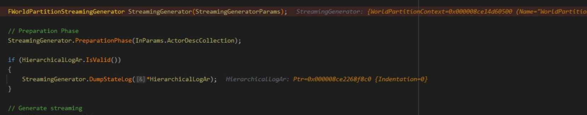

之后会根据指定的RuntimeHash成员类型，进行对应的划分操作，这里一使用默认的UWorldPartitionRuntimeSpatialHash，我们也可以实现自己的RuntimeHash划分方法并在World Setting中指定

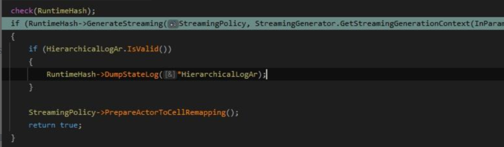

之后就会执行到UWorldPartitionRuntimeSpatialHash的GenerateStreaming
这里再简单说明一下一个RuntimeCell的加载流程：
UWorldPartitionRuntimeCell的具体子类为UWorldPartitionRuntimeLevelStreamingCell，在GenerateStreaming中创建的时候由UWorldPartitionLevelStreamingPolicy::GetRuntimeCellClass指定在定义中实现了父类中加载相关的接口，包括Load、Unload、Activate、Deactivate等操作

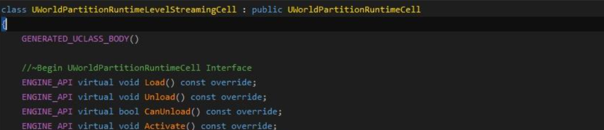

一个Cell正常加载的流程是先Load，然后调用到LocalLevelStreaming->Load：
设置当前的Level(即对应Cell的内容)状态为Loading，不应当被显示，如果正在卸载过程中则停止该状态
将当前StreamingLevel加入到UWorld的StreamingLevelsToConsider列表中
在UWorld的UpdateLevelStreaming方法中处理具体的加载(与之前版本的LevelStreaming加载逻辑相同)
加载完成后StreamingLevel状态修改为LoadedNotVisible
Load结束后的Cell在下一帧会加入到Activate列表，从而执行LocalLevelStreaming->Activate，这里的流程与Load相似不再赘述，当Activate结束后StreamingLevel的状态会变为LoadedVisible，即为一个Cell成功加载和激活。Unload的流程则与之相反，通过SetIsRequestingUnloadAndRemoval注册到UWorld中处理，结束后状态变为Unloaded。
在了解了基础逻辑和加载流程之后，具体来看HLOD的配置。（WP的其他特性就不在这里展开了）
## WP的HLOD Layer    （目录）
HLOD会自己额外建立对应的Grid，内部也有自己的Cell，不会放在MainGrid内也不受WorldSetting的规则影响，而是受HLOD Layer这个配置文件影响。然后HLOD的实现是通过WorldPartitionBuilder方式实现的。
可以通过创建不同类型的HLOD Layer 文件来进行分配不同类型的生成HLOD的规则和加载方式。

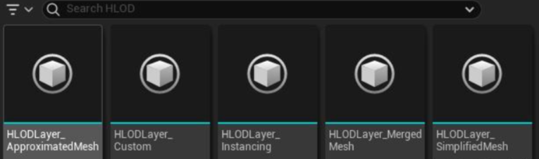

创建完成HLOD Layer 之后需要进行对指定的Actor 进行配置。World Setting 的 Default HLOD Layer 会被Actor 的设置覆盖。
通过指定对应的Actor 来配置场景中的HLOD 烘焙模式。

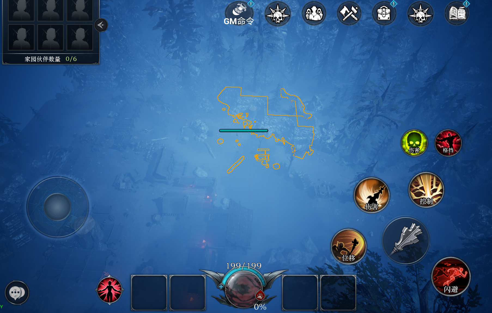

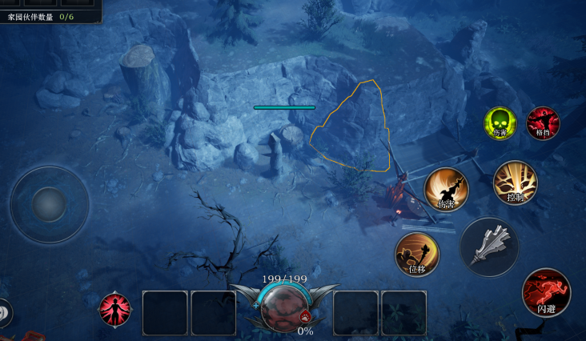

## 在测试场景得到的测试结果 （目录）
通过以上的了解，在Test场景中针对我们当前的场景进行HLOD的合并烘培。烘焙过程相对耗时较长。如果一个地块采用Instance + Simplified 模式大概需要4小时55分钟。（烘培时间成本后续还可以继续测试）本次测试策略是 植被，Landscape 采用 Instance 模式，建筑物等采用 Simplified 模式。
## 遇到的问题
由于默认Cell Size 和Load Range 是3400/ 6400  初次烘焙的所有HLOD 并不能出现在画面中。所以当前的加载配置HLOD没有增益。（了解下HLOD 可以单独设置Cell Size 和 Load Range，但是在不调整Main Layer 的情况下，无论设置多近，HLOD 依然无法出现在画面中。）

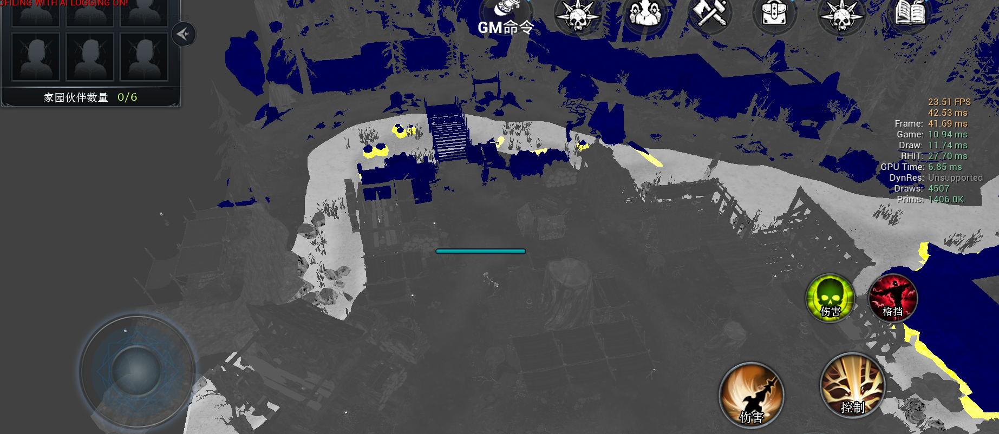

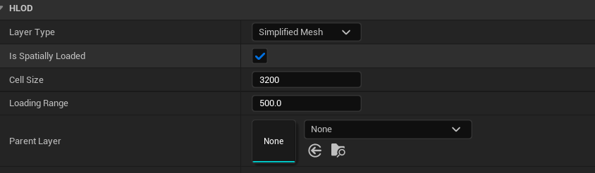

为此做了多次测试。寻找有关Main Layer Cell Size 和 Loading Range 之间的关系。

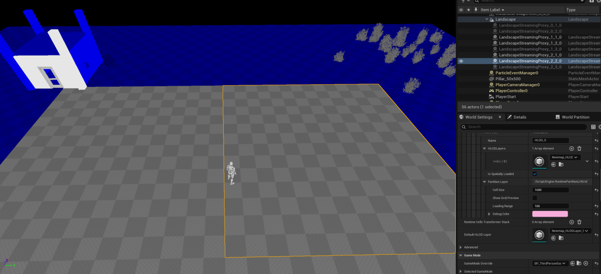

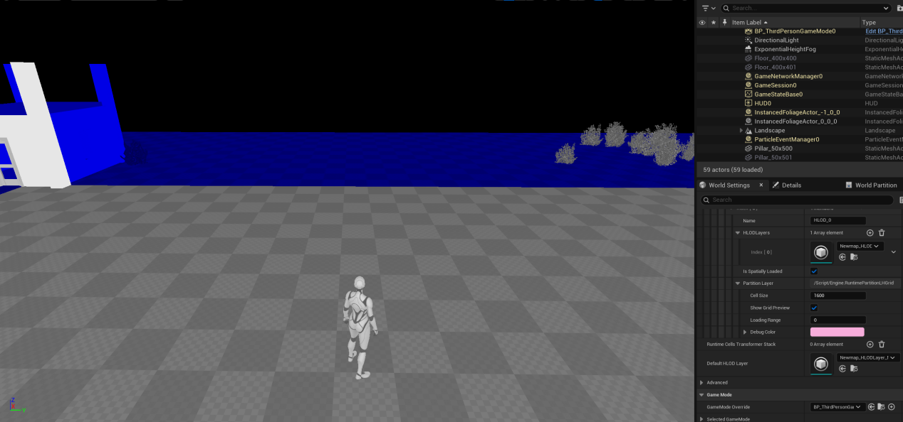

最终在调整了Main Layer 的Loading range 下使得HLOD 出现在画面当中。但是只占了画面的5分之一（Range 设置到1600之后就无法在设置更小了）

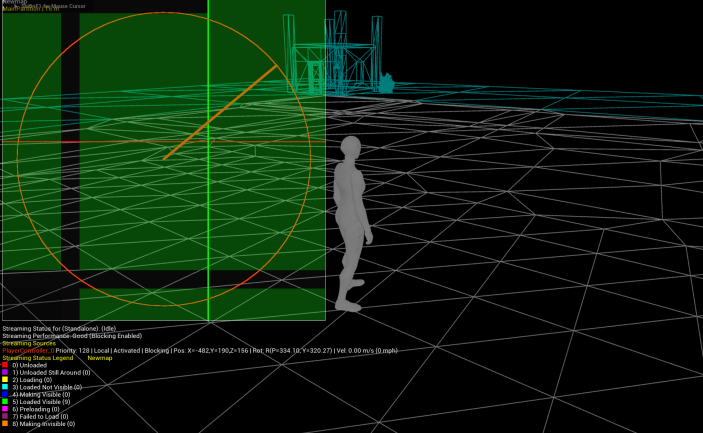

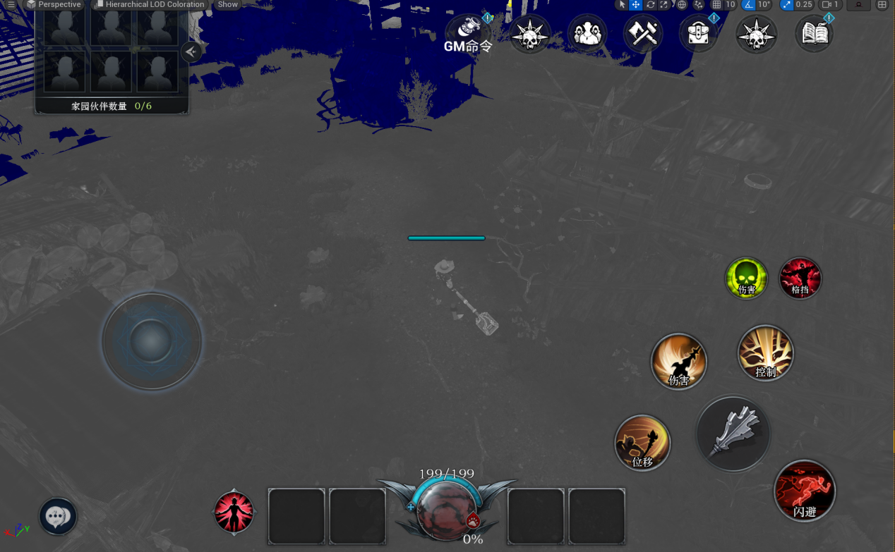

## 测试对比   （目录）
做了对比测试，但是结果不稳定后续可能还需要在进一步测试采样，以此获得更多的数据对比。
这是没有HLOD的默认数据

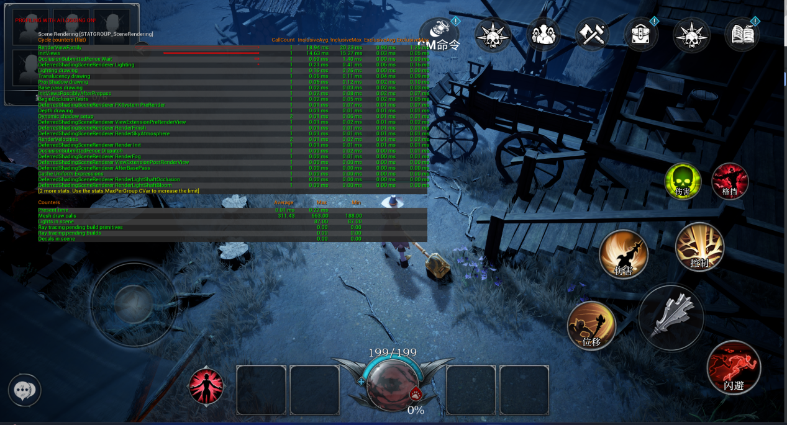

以下是烘培了HLOD，画面中的最上方的棚子和右边的马车是烘焙了HLOD的数据

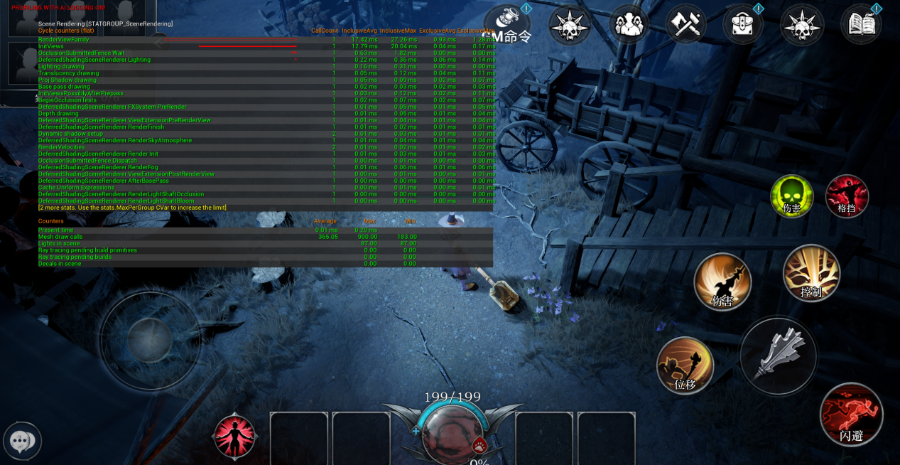

## 经验和技巧   （目录）
Loading Range的大小一般建议是Cell Size的两倍以上，同时Cell Size不宜过小(30m以上)，这样可以避免很多预期外的加载卸载问题，视觉表现也更合理
原本的Actor在划分完Grid后，进行了移动，是否会划分到新的Grid？
Actor的划分是在UWorld::BeginPlay的时候进行的，也又是说一开始就在场景中的静态Actor会按初始位置参与到Grid划分，如果游戏过程中这些Actor发生了移动，则可能会出现预期外的加载卸载。如果有必要的话，需要自己实现重新进行划分的逻辑。
动态创建的Actor是否会划分到某个Cell？默认是不会的。需要自己实现对应的插入逻辑。
可以为不同的物件类型指定不同的Grid Name，从而实现不同类别的物件拥有不同的加载范围和精度(如建筑物加载距离更远，一些放置物可以在更近的距离才加载)，多个Grid在运行时可以同时显示Debug信息

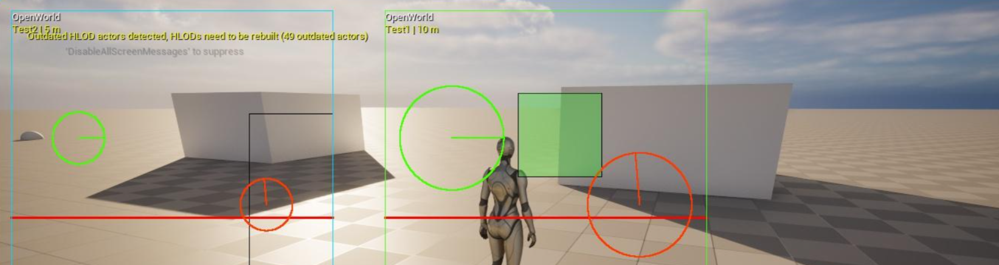

有的时候无法烘焙或者删除之前的HLOD，请确保在烘培之前，提交或者恢复了上一次烘焙的HLOD数据。如果是用的是Perforce 可以尝试离线然后查找出对应的HLOD文件。
烘培需要大量内存，将虚拟内容增加到至少150G. 甚至更高。 - 参考Windows 官网操作。
Grid Loading Range - 当这个值增大时，所有这个Grid 分配的到的Actor 将 Unloaded (Is Spatially Loaded Enabled) 然后 默认的HLOD Layer Enabled.
HLOD Loading Range - 当这个值增大的时候，HLOD 会 Unloaded 然后他的 父级 层级 会被加载，（也是HLOD)
针对使用了Impostors 的 Foliage， 开启 Instanced HLOD With Disallowed Nanite. 你可以尝试使用 Approximated Mesh 为 Nainte 植被。 但是形状会很奇怪。 通常情况的建筑，道具等使用HLOD层级 - Instancing  -  Merged/ Simplified (No Nanite)
确保Non-nanite 植被不会构建Approximated HLOD , 会产生较强的乱序效果。
Approximated 不会使用你设置的材质球，会导致金属，光泽等混乱。 需要设置自定义的木材质，并且在HLOD BuilderMeshApproximate.cpp中 关闭 Options.bUsePackedMRS
如果有些 Actor 没有构建进入 HLOD 尝试检查 Actor 上的 Include Actor in HLOD, 继续查看 Include Component in HLOD, 移动这些Actor 然后保持，在此尝试构建。尝试移动全部Landscape 和所有Actor 到新的关卡里。
如果你无法构建Mini Map 尝试检查世界中是否有 world partition mini map actor， 缩放其大小覆盖整个地图，或许会有帮助。
取消勾选Include actor in HLOD 在Landscape 上， 同时取消 is Spatially Loaded. 目前测试 Nanite Landscape 是最好的优化Landscape 的方式。但是在某些情况下，可能会看到远景的Landscape 会有缺失。 这种情况下，单独构建这个地块的HLOD,或者单独制作网格体。
可以通过commandlet 构建HLOD, 还可以Attach 上 Visual Studio Debugger 和观察到整个细节过程。
确保所有小的模型不要生成HLOD,无论如何你都不会从很远的地方看到他们。可以使用
